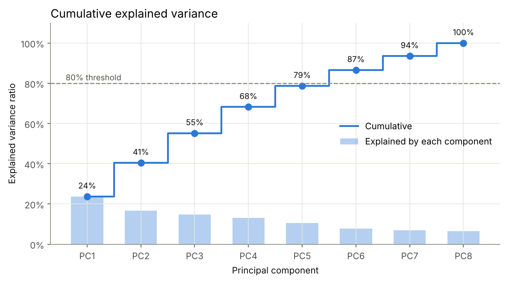

# Session 2: Data Integration, Research Question & PCA

## 1. Research Question & Audience

> **Can Seoul's 행정동 be grouped based on fitness- and bakery-related commercial activity, and what characteristics distinguish these groups?**

We aim to identify distinct groups of 행정동 using estimated sales and store data. We will examine how these groups differ in working and resident populations and explore their relationships with regional obesity rates.

Specifically, we want to find out whether 행정동 differ in

1. how much local spending goes to (fitness vs. bakeries),
2. when gyms are used (morning vs. evening), and
3. who the customers are (age and gender).

### 1.1 Audience
- Urban Planners: Professionals responsible for urban development and designing healthier living environments.

- Public Health Policymakers: Government officials developing policies to address obesity and regional health disparities.

- Public Health Program Planners: Local public health center staff responsible for planning and implementing community health programs.

### 1.2 Relevance

Previous studies, including Park and Yoon (2021) and Shon and Yoon (2025), suggest that obesity-related factors can differ across regions and that urban environments play an important role in public health. Therefore, addressing obesity requires region-specific approaches that consider not only individual behavior but also the physical environment, food environment, and health equity. Our analysis could help identify regional commercial patterns and highlight areas that may require closer attention, providing governments with additional information for creating healthier and more equitable urban environments.

### 1.3 Potential Use
Our findings may help identify areas where additional investigation into park accessibility, walkability, and local food environments would be valuable. For example, regions with relatively high obesity rates and limited fitness-related commercial activity could be prioritized for further assessment of physical activity accessibility.

## 2. Data Integration & Preprocessing

### 2.1 Combined dataset

**What each row represents.** Each row is one 행정동 in 2025. The merged dataset has 425 행정동,
and 365 remain after handling missing values (see below).

**Datasets.**

| Dataset | Source unit | Used for |
|---|---|---|
| Estimated sales | 행정동 x service category x quarter | Bakery and gym transactions, time of day, customer age and gender |
| Stores | 행정동 x service category x quarter | Bakery store share, total store count |
| Sports facility licenses | One row per facility, with coordinates | Licensed gym count per 행정동 |
| Resident population | 행정동 x quarter | Context only |
| Worker population | 행정동 x quarter | Context only |
| Obesity rate | 자치구 | Context only |

"Bakery" is the `Bakery` service category. "Gym" combines `Sports Club` and `Sports Instruction`; golf driving ranges are excluded.

**Identifiers.** Datasets are joined on the 행정동 code. Obesity rates are joined on the 자치구 code, 
which is the first five digits of the 행정동 code.

**Aggregation and transformation before merging.**
- Quarterly rows were collapsed to one row per 행정동. Sales are flows, so the four quarters were **summed**. Store counts and populations are stocks, so the four quarters were **averaged**.
- The license data has no 행정동 code and uses 법정동 addresses, so each facility was assigned to a 행정동 with a **spatial join** on its coordinates (EPSG:5174 converted to EPSG:4326). Three 행정동 that were reorganized in the newer boundary file (용신동, 일원2동, 상일동) were mapped back to their earlier codes.

**Checks against duplication and incompatible units.**
- Every merge used `validate="one_to_one"`, and the row count stayed at 425 with no duplicate codes.
- Obesity is measured at the 자치구 level, so every 행정동 in a 자치구 shares the same value. Because this is a different geographic unit, obesity is **not** used as a PCA input.

### 2.2 Preparing variables for PCA

**Missing values.** 60 행정동 had no bakery or no gym transactions, so their shares could not be calculated. We dropped them instead of imputing, because imputing would invent customers that do not exist. 365 행정동 remain.

**Variable selection.** We used shares and densities rather than raw counts or sales totals. With raw counts, PC1 would mostly separate large 행정동 from small ones.

Excluded from PCA:
- Identifiers (행정동 code and name)
- Raw counts and sales totals (measure size, not composition)
- Obesity rate (different geographic unit)
- Resident population, worker population, worker share (kept to describe groups later)

No categorical variables are encoded.

**Transformation and standardization.** Several shares were strongly right-skewed. Variables with skewness between 1 and 3 were square-root transformed, and those above 3 were log transformed. All 8 variables were then z-score standardized. The variables have different units, and PCA is not scale invariant, so without standardization the variable with the largest variance would dominate.

## 3. Applying our PCA

### 3.1 Input Variables

| Group | Variable | Meaning |
|---|---|---|
| Activity | bakery_txn_share | Share of all transactions made at bakeries |
| | gym_txn_share | Share of all transactions made at gyms |
| Timing | gym_morning_share | Share of gym transactions between 06:00 and 11:00 |
| | gym_evening_share | Share of gym transactions between 17:00 and 24:00 |
| Customers | bakery_young_share | Share of bakery customers in their 20s and 30s |
| | gym_female_share | Share of gym customers who are female |
| Supply | bakery_store_share | Bakeries as a share of all stores |
| | gym_density | Licensed gyms per 1,000 stores |

### 3.2 Component Selection

| Component | Eigenvalue | Explained variance | Cumulative |
|---|---|---|---|
| **PC1** | 1.904 | 23.7% | 23.7% |
| **PC2** | 1.345 | 16.8% | 40.5% |
| **PC3** | 1.180 | 14.7% | 55.2% |
| **PC4** | 1.045 | 13.0% | 68.2% |
| PC5 | 0.841 | 10.5% | 78.7% |
| PC6 | 0.631 | 7.9% | 86.6% |
| PC7 | 0.556 | 6.9% | 93.5% |
| PC8 | 0.519 | 6.5% | 100.0% |

| Rule of thumb (lecture) | Components | Variance kept |
|---|---|---|
| Cumulative variance ≥ 80% | 6 | 86.6% |
| Above-average variance (eigenvalue > 1) | **4** | **68.2%** |
| Scree plot elbow | No sharp elbow after PC1 | — |

> We retain **4 components**. The input variables are only weakly correlated (the strongest correlation is −0.46), so variance is spread across many directions and reaching 80% would require keeping most of them.

### 3.3 Component Interpretation

Strong contribution = |loading| > 0.3 (lecture rule of thumb). Values marked * are borderline (≈ 0.30).

| PC | Positive loadings | Negative loadings | Interpretation |
|---|---|---|---|
| **PC1** (23.7%) | `gym_txn_share` 0.51, `gym_morning_share` 0.47, `gym_density` 0.46 | `gym_evening_share` −0.45 | Gym activity & morning exercise |
| **PC2** (16.8%) | `bakery_txn_share` 0.60, `gym_evening_share` 0.39 | `bakery_young_share` −0.40, `gym_morning_share` −0.38 | Bakery spending with an older customer base |
| **PC3** (14.7%) | `bakery_young_share` 0.68, `bakery_store_share` 0.67 | — | Young bakery districts |
| **PC4** (13.0%) | `gym_female_share` 0.79, `gym_morning_share` 0.30* | `gym_density` −0.38, `gym_txn_share` −0.30* | Female share of gym customers |

Fitness variables load mainly on PC1, while bakery variables load mainly on PC2 and PC3,
so fitness and bakery activity are separate dimensions rather than two ends of one axis.

### 3.4 Visualization and Discussion

**Visible patterns**
- **No separate groups.** 행정동 form one round cloud around the origin. PCA shows directions of variation, not clusters.
- **PC1 reflects gym activity.** `gym_txn_share` and `gym_density` point right together: 행정동 with more gym spending also have more gyms.
- **Morning vs. evening.** `gym_morning_share` and `gym_evening_share` point in opposite directions, the strongest negative relationship in the data.
- **Bakery spending vs. young customers.** Along PC2, `bakery_txn_share` points up and `bakery_young_share` points down.
- **Short arrows.** `bakery_store_share` and `gym_female_share` are poorly represented here; they load on PC3 and PC4, which is why four components are retained.
- **Bakery and gym arrows are not opposite.** A 행정동 with high bakery spending does not necessarily have low gym activity.

**Relation to our research question and audience**
- Because fitness and bakery activity vary separately, groups found in Project 3 may combine different levels of each rather than splitting into "bakery areas" vs. "fitness areas."
- **Urban planners:** 행정동 with low PC1 scores have little fitness-related activity and are candidates for checking park access and walkability.
- **Public health policymakers:** food (PC2, PC3) and physical activity (PC1) environments should be assessed with separate indicators.
- **Public health program planners:** PC1 separates morning- from evening-oriented gym areas, which can guide program scheduling.

> **Next step (Project 3):** cluster 행정동 on the four retained components, compare clusters by resident and worker population, and relate them to obesity at the 자치구 level.

## References

- Park, S., & Yoon, S. (2021). Development of a Big Data Machine Learning Model for Estimating Obesity Factors. Seoul Institute

- Shon, C., & Yoon, N. (2025). Environmental Factors Affecting Obesity in Urban Residents in Metropolitan Area. Research Article
