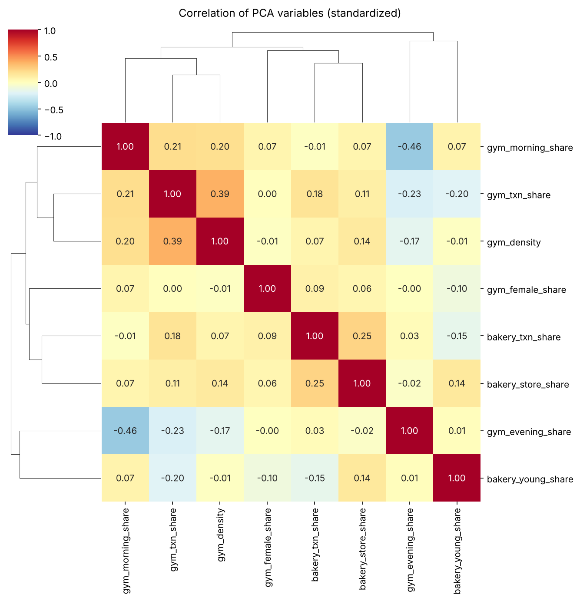
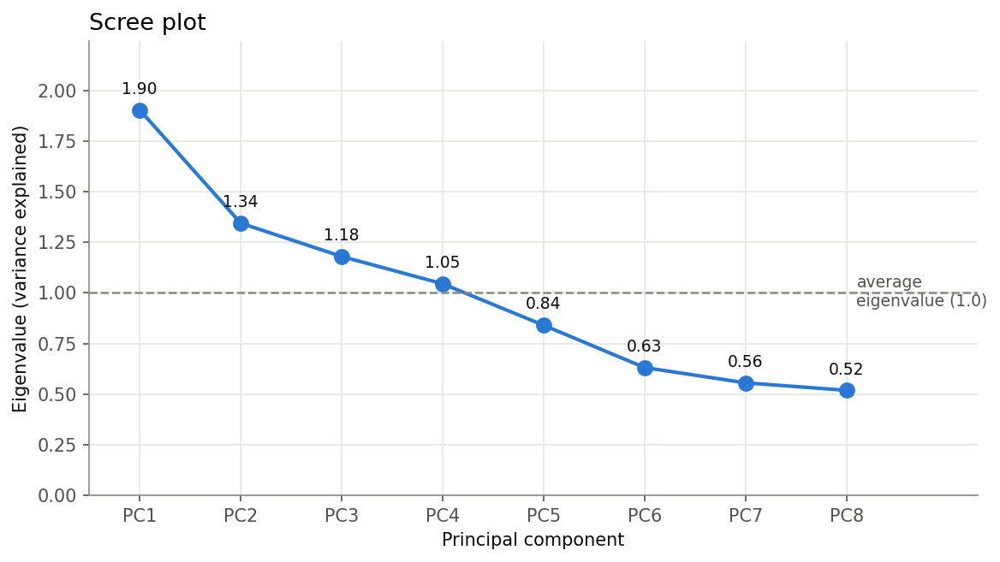
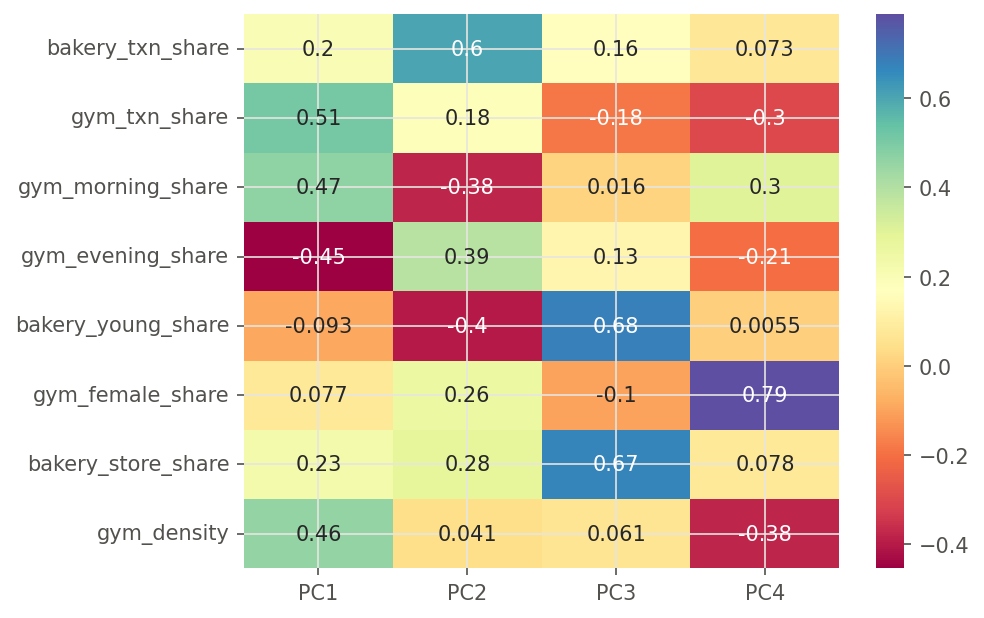
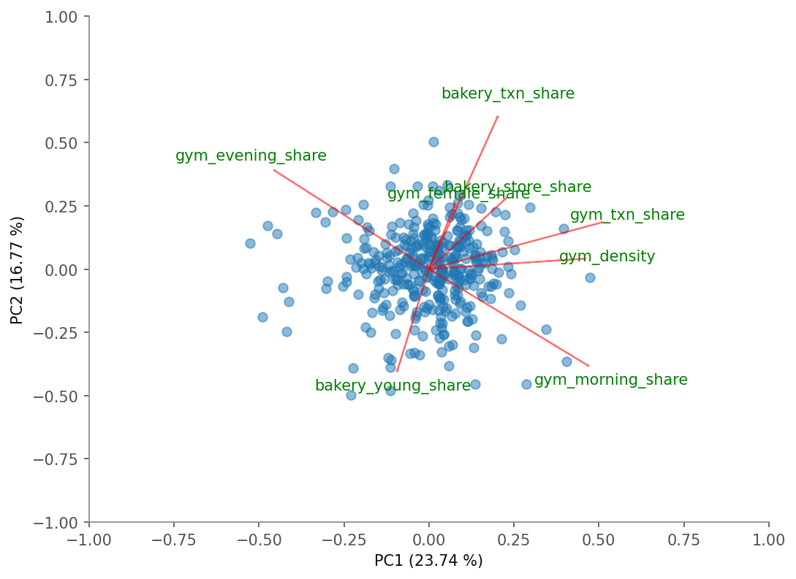

# Session 2: Data Integration, Research Question & PCA

Code and outputs: [Data integration notebook](notebooks/01_data_integration.ipynb) | [PCA notebook](notebooks/02_pca.ipynb) | Data sources and access instructions: [data/README.md](data/README.md)

## 1. Research Question & Audience

> **Can Seoul's 행정동 be grouped based on fitness- and bakery-related commercial activity, and what characteristics distinguish these groups?**

We aim to identify distinct groups of 행정동 using estimated sales and store data. We will examine how these groups differ in working and resident populations and explore their relationships with regional obesity rates.

Specifically, we want to find out whether 행정동 differ in

1. how much local spending goes to fitness vs. bakeries,
2. when gyms are used (morning vs. evening), and
3. who the customers are (age and gender).

### 1.1 Audience
- Urban Planners: Professionals responsible for urban development and designing healthier living environments, such as the Seoul Metropolitan Government urban planning staff who decide where parks, walking paths, and public sports facilities go. They need to know which 행정동 have little fitness-related activity.

- Public Health Policymakers: Government officials developing policies to address obesity and regional health disparities across Seoul's 25 자치구. They need to know whether the food environment and the physical activity environment differ between areas, and whether these differences line up with obesity rates.

- Public Health Program Planners: Staff at each 자치구 public health center (보건소) responsible for planning and implementing community health programs. They need to know which 행정동 to target, at what time of day, and for which customer groups.

### 1.2 Relevance

Previous studies, including Park and Yoon (2021) and Shon and Yoon (2025), suggest that obesity-related factors can differ across regions and that urban environments play an important role in public health. Therefore, addressing obesity requires region-specific approaches that consider not only individual behavior but also the physical environment, food environment, and health equity. Obesity data in Seoul is only available at the 자치구 level, so it cannot show differences between neighborhoods inside a 자치구. Our analysis could help identify regional commercial patterns at the smaller 행정동 level and highlight areas that may require closer attention, providing governments with additional information for creating healthier and more equitable urban environments.

### 1.3 Potential Use
Our findings may help identify areas where additional investigation into park accessibility, walkability, and local food environments would be valuable. For example, regions with relatively high obesity rates and limited fitness-related commercial activity could be prioritized for further assessment of physical activity accessibility. A 보건소 could also use the timing and customer patterns to decide when and where to run programs, for example a morning walking program in 행정동 where gyms are mostly used in the evening. Our findings will indicate associations rather than causal relationships.

## 2. Data Integration & Preprocessing

### 2.1 Combined dataset

**What each row represents.** Each row is one 행정동 in 2025 (Q1 to Q4 combined). The merged dataset has 425 행정동,
and 365 remain after handling missing values (see below).

**Datasets.**

| Dataset | Source unit | Used for |
|---|---|---|
| Estimated sales **(primary)** | 행정동 x service category x quarter | Bakery and gym transactions, time of day, customer age and gender |
| Stores | 행정동 x service category x quarter | Bakery store share, total store count |
| Sports facility licenses | One row per facility, with coordinates | Licensed gym count per 행정동 |
| 행정동 boundaries (vuski/admdongkor, ver20250701) | One polygon per 행정동 | Placing each licensed gym inside a 행정동 |
| Resident population | 행정동 x quarter | Context only |
| Worker population | 행정동 x quarter | Context only |
| Obesity rate | 자치구 | Context only |

All datasets were translated from Korean to English by our team without changing any values. Sources, links, and file descriptions are in [data/README.md](data/README.md).

"Bakery" is the `Bakery` service category. "Gym" combines `Sports Club` and `Sports Instruction`; golf driving ranges are excluded.

**Identifiers.** Datasets are joined on the 행정동 code. Obesity rates are joined on the 자치구 code, 
which is the first five digits of the 행정동 code. The license data has no code at all, so it is connected through location (coordinates).

**Aggregation and transformation before merging.**
- All datasets were filtered to 2025 (quarters 20251 to 20254).
- Quarterly rows were collapsed to one row per 행정동. Sales are flows, so the four quarters were **summed**. Store counts and populations are stocks, so the four quarters were **averaged**.
- The license data has no 행정동 code and uses 법정동 addresses, so each facility was assigned to a 행정동 with a **spatial join** on its coordinates (EPSG:5174 converted to EPSG:4326). We kept the 4,561 gyms operating at some point in 2025; 87 had no coordinates, so 4,474 were placed, and all of them fell inside a 행정동. Three 행정동 that were reorganized in the newer boundary file (용신동, 일원2동, 상일동) were mapped back to their earlier codes.

**Checks against duplication and incompatible units.**
- Every 행정동-level merge used `validate="one_to_one"`, and the obesity merge used `validate="many_to_one"` (many 행정동 share one 자치구). The row count stayed at 425 with no duplicate codes.
- All 425 행정동 received an obesity value (all 25 자치구 matched). 11 행정동 have no worker population, but it is not a PCA input, so they were kept.
- Obesity is measured at the 자치구 level, so every 행정동 in a 자치구 shares the same value. Because this is a different geographic unit, obesity is **not** used as a PCA input.

### 2.2 Preparing variables for PCA

**Missing values.** 60 행정동 had no bakery or no gym transactions (46 had no bakery transactions, 28 had no gym transactions, and 14 had neither), so their shares could not be calculated. We dropped them instead of imputing, because imputing would invent customers that do not exist. 365 행정동 remain, and all 25 자치구 are still represented.

The gender and age columns do not always add up to the total number of transactions (some card transactions have no customer information). So the female share and the 20s and 30s share are divided by the transactions where gender or age is known.

**Variable selection.** We used shares and densities rather than raw counts or sales totals. With raw counts, PC1 would mostly separate large 행정동 from small ones.

Excluded from PCA:
- Identifiers (행정동 code and name, 자치구 code and name)
- Raw counts and sales totals (measure size, not composition)
- Day-of-week columns (overlap with the time and weekday/weekend information)
- Obesity rate (different geographic unit)
- Resident population, worker population, worker share (kept to describe groups later)

No categorical variables are encoded.

**Transformation and standardization.** Several shares were strongly right-skewed. Variables with skewness between 1 and 3 were square-root transformed (bakery_txn_share, bakery_store_share), and those above 3 were log transformed (gym_txn_share, skew 14.48 to -0.84). We first tried `log1p`, but our shares are very small numbers, so `log1p` barely changed them. All 8 variables were then z-score standardized. The variables have different units, and PCA is not scale invariant, so without standardization the variable with the largest variance would dominate.

No pair of variables has |r| > 0.9, so none of them measure the same thing twice.

## 3. Applying our PCA

### 3.1 Input Variables

| Group | Variable | Meaning | Transformation |
|---|---|---|---|
| Activity | bakery_txn_share | Share of all transactions made at bakeries | Square root |
| | gym_txn_share | Share of all transactions made at gyms | Log |
| Timing | gym_morning_share | Share of gym transactions between 06:00 and 11:00 | None |
| | gym_evening_share | Share of gym transactions between 17:00 and 24:00 | None |
| Customers | bakery_young_share | Share of bakery customers in their 20s and 30s | None |
| | gym_female_share | Share of gym customers who are female | None |
| Supply | bakery_store_share | Bakeries as a share of all stores | Square root |
| | gym_density | Licensed gyms per 1,000 stores | None |

**Preprocessing.** The PCA input has 365 행정동 and no missing values, since 행정동 without bakery or gym transactions were dropped (section 2.2). Differences in measurement scale were handled by transforming the skewed variables and then standardizing all 8 variables to a mean of 0 and a standard deviation of 1, so each variable contributes a variance of 1.

### 3.2 Component Selection

| Component | Eigenvalue | Explained variance | Cumulative |
|---|---|---|---|
| **PC1** | 1.904 | 23.7% | 23.7% |
| **PC2** | 1.345 | 16.8% | 40.5% |
| **PC3** | 1.180 | 14.7% | 55.2% |
| **PC4** | 1.045 | 13.0% | 68.2% |
| PC5 | 0.841 | 10.5% | 78.7% |
| PC6 | 0.631 | 7.9% | 86.6% |
| PC7 | 0.556 | 6.9% | 93.5% |
| PC8 | 0.519 | 6.5% | 100.0% |

| Rule of thumb (lecture) | Components | Variance kept |
|---|---|---|
| Cumulative variance ≥ 80% | 6 | 86.6% |
| Above-average variance (eigenvalue > 1) | **4** | **68.2%** |
| Scree plot elbow | No sharp elbow after PC1 | Not conclusive |

> We retain **4 components**, which explain **68.2%** of the variance.

- PC1 to PC4 each explain more variance than a single original variable (eigenvalue > 1). PC5 to PC8 each explain less than one original variable, so keeping them would not summarize the data better than the variables themselves.
- Reaching 80% would require 6 of our 8 components, which barely reduces the number of dimensions and goes against the reason we use PCA before clustering.
- The input variables are only weakly correlated (the strongest correlation is −0.46, gym morning share vs. gym evening share), so variance is spread across many directions and no small set of components can reach 80%. The trade-off is that we lose 31.8% of the variance. In Project 3 we will also cluster with 6 components to check whether the groups change.

### 3.3 Component Interpretation

Strong contribution = |loading| > 0.3 (lecture rule of thumb). Values marked * are borderline (≈ 0.30).

| PC | Positive loadings | Negative loadings | Interpretation |
|---|---|---|---|
| **PC1** (23.7%) | `gym_txn_share` 0.51, `gym_morning_share` 0.47, `gym_density` 0.46 | `gym_evening_share` −0.45 | Gym activity & morning exercise |
| **PC2** (16.8%) | `bakery_txn_share` 0.60, `gym_evening_share` 0.39 | `bakery_young_share` −0.40, `gym_morning_share` −0.38 | Bakery spending with an older customer base, and evening gym use |
| **PC3** (14.7%) | `bakery_young_share` 0.68, `bakery_store_share` 0.67 | None | Young bakery districts |
| **PC4** (13.0%) | `gym_female_share` 0.79, `gym_morning_share` 0.30* | `gym_density` −0.38, `gym_txn_share` −0.30* | Female share of gym customers, in areas with fewer gyms |

Fitness variables load mainly on PC1, while bakery variables load mainly on PC2 and PC3,
so fitness and bakery activity are separate dimensions rather than two ends of one axis.

PC2 also looks like a residential vs. office dimension: 행정동 with high PC2 scores have a lower worker share (r = −0.39 between PC2 scores and worker share). In other words, high PC2 describes residential neighborhoods where people buy bakery goods, bakery customers are older, and people go to the gym after work.

### 3.4 Visualization and Discussion

The biplot shows only PC1 and PC2 (40.5% of the variance). We retain 4 components for the next stage, so PC3 and PC4 are not visible here.

**Visible patterns**
- **No separate groups.** 행정동 form one round cloud around the origin. PCA shows directions of variation, not clusters.
- **PC1 reflects gym activity.** `gym_txn_share` and `gym_density` point right together: 행정동 with more gym spending also have more gyms.
- **Morning vs. evening.** `gym_morning_share` and `gym_evening_share` point in opposite directions, the strongest negative relationship in the data.
- **Bakery spending vs. young customers.** Along PC2, `bakery_txn_share` points up and `bakery_young_share` points down.
- **Short arrows.** `bakery_store_share` and `gym_female_share` are poorly represented here; they load on PC3 and PC4, which is why four components are retained.
- **Bakery and gym arrows are not opposite.** Both point toward the upper right, so a 행정동 with high bakery spending does not necessarily have low gym activity. Seoul does not split into "bulk" and "cut" neighborhoods along one axis.

**Preliminary check: components and obesity**

Obesity was not used in PCA, so we can compare it with the component scores afterward. Since obesity is only available by 자치구, we averaged the component scores of the 행정동 in each 자치구 and compared them with the 자치구 obesity rate (25 자치구).

| Component | Correlation with 자치구 obesity rate | p-value |
|---|---|---|
| PC1 (gym activity & morning exercise) | −0.28 | 0.17 |
| PC2 (bakery spending, older customers, evening gym) | **0.57** | **0.003** |
| PC3 (young bakery districts) | −0.37 | 0.07 |
| PC4 (female gym customers) | −0.10 | 0.63 |

Only PC2 shows a clear relationship: 자치구 whose 행정동 score high on PC2 tend to have higher obesity rates (for example Gangdong-gu, Nowon-gu, and Eunpyeong-gu), while central and office-heavy 자치구 such as Jung-gu, Yongsan-gu, and Gangnam-gu score low on PC2 and have lower obesity rates. This is based on only 25 자치구 and shows an association, not a cause. PC2 also reflects residential vs. office areas, so the relationship may come from who lives in these areas rather than from bakeries themselves.

**Relation to our research question and audience**
- Because fitness and bakery activity vary separately, groups found in Project 3 may combine different levels of each rather than splitting into "bakery areas" vs. "fitness areas."
- **Urban planners:** 행정동 with low PC1 scores have little fitness-related activity and are candidates for checking park access and walkability.
- **Public health policymakers:** food (PC2, PC3) and physical activity (PC1) environments should be assessed with separate indicators. The link between PC2 and obesity suggests that residential 자치구 with high bakery spending may deserve a closer look.
- **Public health program planners:** PC1 separates morning- from evening-oriented gym areas, which can guide program scheduling.

> **Next step (Project 3):** cluster 행정동 on the four retained components, compare clusters by resident and worker population, and relate them to obesity at the 자치구 level.

## References

- Park, S., & Yoon, S. (2021). Development of a Big Data Machine Learning Model for Estimating Obesity Factors. Seoul Institute

- Shon, C., & Yoon, N. (2025). Environmental Factors Affecting Obesity in Urban Residents in Metropolitan Area. Research Article
